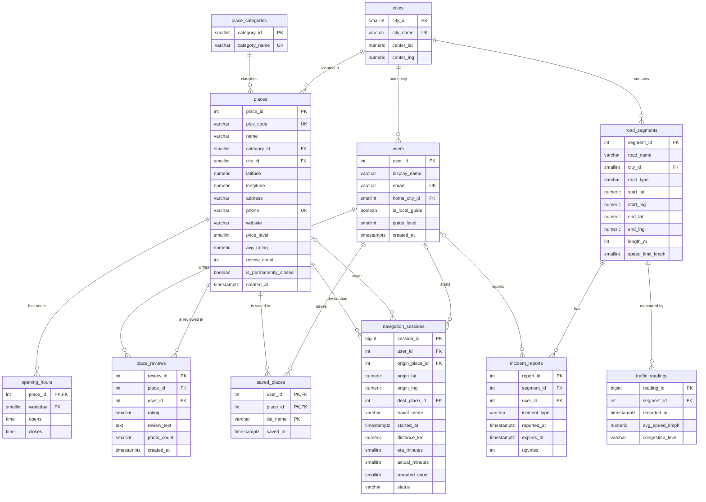

# Phase 2: Schema Design

**Project:** Google Maps Navigation Database (DBMS) · **Team:** T0030 · **Section:** A · **DBMS:** PostgreSQL 15+
**Schema:** `gmaps` · **Source of truth:** the 11 CSV files in `seed_data/` (no `CREATE TABLE` was provided)

| Role | Name | Enrollment No. | GitHub |
| ---- | ---- | -------------- | ------ |
| Group Lead | Suryanshu Tiwari | 2501010466 | Suryanshu-Tiwari-gh |
| Member 2 | Resmanth Kumar Beesetti | 2501010374 | resmanth |
| Member 3 | Gagandeep | 2501010163 | gagandeep3016-sudo |
| Member 4 | Aditya Dhanraj Singh | 2501010034 | adityasingh916 |

> **How to finish this file:** every `{{ ... }}` is a number you must paste from your own run, and every 🔶 marks a value list or rule that must be confirmed with the profiling queries in Appendix A. Delete this note and the 🔶 markers when done.

---

## 1. Approach

The schema was reverse-engineered from the data, not guessed. For every file we:

1. Loaded the CSV into a scratch table with all columns as `TEXT` and profiled it (Appendix A): distinct values, min/max, NULL counts, duplicate keys, string lengths.
2. Chose the narrowest correct type, then wrote constraints only for rules the data **obeys** and the business **needs**.
3. Cross-checked against the 30 workload queries. Several queries fix design decisions (see §9).
4. Loaded the real data into the constrained schema. Any rejected row is documented in §12 as either a wrong constraint (we fixed it) or a genuine data problem (we kept the constraint and explain it).

**Phase 2 rule respected:** only PK, FK, UNIQUE, NOT NULL and CHECK exist. No other index was created.

### Schema at a glance

| # | Table | Rows (seed) | Primary key | Parents (FK) |
| - | ----- | ----------- | ----------- | ------------ |
| 1 | `cities` | 10 | `city_id` | none |
| 2 | `place_categories` | 12 | `category_id` | none |
| 3 | `places` | 40,042 | `place_id` | cities, place_categories |
| 4 | `opening_hours` | 252,266 | `(place_id, weekday)` | places |
| 5 | `users` | 40,000 | `user_id` | cities |
| 6 | `place_reviews` | 89,998 | `review_id` | places, users |
| 7 | `saved_places` | 50,000 | `(user_id, place_id, list_name)` | users, places |
| 8 | `road_segments` | 2,000 | `segment_id` | cities |
| 9 | `traffic_readings` | 250,000 | `reading_id` | road_segments |
| 10 | `navigation_sessions` | 200,000 | `session_id` | users, places (×2) |
| 11 | `incident_reports` | 12,000 | `report_id` | road_segments, users |

**Load order (parents before children):** cities → place_categories → places → users → road_segments → opening_hours → place_reviews → saved_places → traffic_readings → incident_reports → navigation_sessions.

---

## 2. Data dictionary

Type choices follow one rule set: **exact decimals for coordinates and ratings** (no float drift), **`TIMESTAMPTZ` for every timestamp** (the CSV carries a `+05:30` offset), **`BOOLEAN` for `t`/`f` columns**, **`SMALLINT` for small bounded integers**, **`INTEGER` where 20× growth still fits in 2.1 billion**, **`BIGINT` only for the two fast-growing event tables**, and **`VARCHAR(n)` for short codes** (not `TEXT` everywhere). There is no money column: `price_level` is a 1–4 tier, not an amount.

### 2.1 `cities`

| Column | Type | Null? | Constraint | Why |
| ------ | ---- | ----- | ---------- | --- |
| city_id | SMALLINT | NOT NULL | PK | Only 10 cities; 2 bytes is enough and keeps every FK column to `cities` small. |
| city_name | VARCHAR(50) | NOT NULL | UNIQUE | Natural candidate key; R19 and the app look cities up by name. |
| center_lat | NUMERIC(9,6) | NOT NULL | CHECK −90…90 | Six decimals ≈ 0.1 m; exact. |
| center_lng | NUMERIC(9,6) | NOT NULL | CHECK −180…180 | Same. |

### 2.2 `place_categories`

| Column | Type | Null? | Constraint | Why |
| ------ | ---- | ----- | ---------- | --- |
| category_id | SMALLINT | NOT NULL | PK | 12 rows. |
| category_name | VARCHAR(50) | NOT NULL | UNIQUE | R19 looks up `'Hospital'` by name, so a name must identify one category. |

### 2.3 `places`

| Column | Type | Null? | Constraint | Why |
| ------ | ---- | ----- | ---------- | --- |
| place_id | INTEGER | NOT NULL | PK | 801k places at 20×: INTEGER is enough; BIGINT would double the width of every FK and index. |
| plus_code | VARCHAR(12) | NOT NULL | UNIQUE, CHECK format | Plus Code is a location-derived public identifier, so it is a **candidate key** (R23 searches by it). Format: 8 chars, `+`, 2–3 chars from the 20-symbol Plus Code alphabet. |
| name | VARCHAR(150) | NOT NULL | — | Every place has a name. |
| category_id | SMALLINT | NOT NULL | FK → place_categories, RESTRICT | A place always has a category. |
| city_id | SMALLINT | NOT NULL | FK → cities, RESTRICT | A place always belongs to a city. |
| latitude | NUMERIC(9,6) | NOT NULL | CHECK −90…90 | Needed for "near me" (R01). |
| longitude | NUMERIC(9,6) | NOT NULL | CHECK −180…180 | Same. |
| address | VARCHAR(255) | NOT NULL | — | Display string; never empty. |
| phone | VARCHAR(20) | **NULL** | UNIQUE, CHECK E.164 format | Many places (ATMs, petrol pumps) have no phone. UNIQUE ignores NULLs, so many NULLs are fine. 🔶 |
| website | VARCHAR(255) | **NULL** | CHECK starts with `http://` or `https://` | Optional business information. |
| price_level | SMALLINT | **NULL** | CHECK 1…4 | Empty for categories where price tiers make no sense (e.g. hospitals, as in row 2 of the CSV). 🔶 |
| avg_rating | NUMERIC(2,1) | **NULL** | CHECK 1.0…5.0 | NULL when a place has no reviews yet. One decimal matches `round(avg(rating),1)` in R15/W04. |
| review_count | INTEGER | NOT NULL | DEFAULT 0, CHECK ≥ 0 | Zero is a valid, meaningful value, so NULL is not needed. |
| is_permanently_closed | BOOLEAN | NOT NULL | DEFAULT FALSE | **Must be NOT NULL**: R01 and R04 use `NOT is_permanently_closed`, and `NOT NULL` evaluates to NULL, which would silently drop rows. |
| created_at | TIMESTAMPTZ | NOT NULL | — | Listing creation time with offset. |

### 2.4 `opening_hours`

| Column | Type | Null? | Constraint | Why |
| ------ | ---- | ----- | ---------- | --- |
| place_id | INTEGER | NOT NULL | PK (part), FK → places, **CASCADE** | Hours have no meaning without their place. |
| weekday | SMALLINT | NOT NULL | PK (part), CHECK 1…7 | ISO numbering, Monday = 1 … Sunday = 7 (R02 uses 2 = Tuesday, R04 uses 6 = Saturday). |
| opens | TIME | NOT NULL | — | A time of day, not a timestamp: it repeats every week. |
| closes | TIME | NOT NULL | — | May be **earlier than `opens`**: that means the place closes after midnight (R04 handles both cases). So there is deliberately **no** `opens < closes` check. |

A place with no rows in this table has no known hours (R21); that is data, not an error.

### 2.5 `users`

| Column | Type | Null? | Constraint | Why |
| ------ | ---- | ----- | ---------- | --- |
| user_id | INTEGER | NOT NULL | PK | 40k users. |
| display_name | VARCHAR(100) | NOT NULL | — | Shown on reviews (R05, R14). |
| email | VARCHAR(255) | NOT NULL | UNIQUE, CHECK basic format | Login identifier; two accounts cannot share one. |
| home_city_id | SMALLINT | NOT NULL | FK → cities, RESTRICT | 🔶 Every user in the export has a home city. |
| is_local_guide | BOOLEAN | NOT NULL | DEFAULT FALSE | Used in R05. |
| guide_level | SMALLINT | **NULL** | CHECK 1…10 | Only Local Guides have a level. |
| created_at | TIMESTAMPTZ | NOT NULL | — | Sign-up time. |

Cross-column rule: `is_local_guide` ⇔ `guide_level IS NOT NULL` (CHECK `ck_users_guide_level_consistent`).

### 2.6 `place_reviews`

| Column | Type | Null? | Constraint | Why |
| ------ | ---- | ----- | ---------- | --- |
| review_id | INTEGER | NOT NULL | PK | 1.8M reviews at 20×. |
| place_id | INTEGER | NOT NULL | FK → places, CASCADE | A review of a deleted place is meaningless. |
| user_id | INTEGER | NOT NULL | FK → users, CASCADE | Reviews are personal content and go with the account. |
| rating | SMALLINT | NOT NULL | CHECK 1…5 | Star rating. |
| review_text | TEXT | **NULL** | — | Free text of unbounded length; a rating-only review is legitimate. 🔶 |
| photo_count | SMALLINT | NOT NULL | DEFAULT 0, CHECK ≥ 0 | Summed in R14. |
| created_at | TIMESTAMPTZ | NOT NULL | — | Used for ordering (R05, R22). |
| — | — | — | **UNIQUE (place_id, user_id)** | One review per user per place. W02 uses `ON CONFLICT (place_id, user_id)`, which **requires** this unique constraint to exist; without it W02 fails with an error. |

### 2.7 `saved_places`

| Column | Type | Null? | Constraint | Why |
| ------ | ---- | ----- | ---------- | --- |
| user_id | INTEGER | NOT NULL | PK (part), FK → users, CASCADE | A saved list belongs to the user. |
| place_id | INTEGER | NOT NULL | PK (part), FK → places, CASCADE | Saving a deleted place is meaningless. |
| list_name | VARCHAR(30) | NOT NULL | PK (part), CHECK IN (…) 🔶 | The same place can be in several lists (e.g. "Starred" and "Want to go"), so `(user_id, place_id)` alone is **not** the key. |
| saved_at | TIMESTAMPTZ | NOT NULL | — | Used for ordering (R06). |

This is an **M:N** relationship between users and places; the table is its junction table and `list_name` is part of the relationship.

### 2.8 `road_segments`

| Column | Type | Null? | Constraint | Why |
| ------ | ---- | ----- | ---------- | --- |
| segment_id | INTEGER | NOT NULL | PK | 2,000 segments. |
| road_name | VARCHAR(100) | NOT NULL | — | Not unique by design: several segments can belong to one road, and R07 matches `'Outer Ring Road%'`. |
| city_id | SMALLINT | NOT NULL | FK → cities, RESTRICT | Segment belongs to one city. |
| road_type | VARCHAR(15) | NOT NULL | CHECK IN (…) 🔶 | Short code (`ARTERIAL`, …), grouped in R25. |
| start_lat / start_lng | NUMERIC(9,6) | NOT NULL | CHECK ranges | Segment geometry endpoints. |
| end_lat / end_lng | NUMERIC(9,6) | NOT NULL | CHECK ranges | Same. |
| length_m | INTEGER | NOT NULL | CHECK > 0 | A segment has positive length. |
| speed_limit_kmph | SMALLINT | NOT NULL | CHECK 5…130 | Compared with readings in R25. |

### 2.9 `traffic_readings`

| Column | Type | Null? | Constraint | Why |
| ------ | ---- | ----- | ---------- | --- |
| reading_id | BIGINT | NOT NULL | PK | Fast-growing event table (5M rows at 20×, more at 100×). |
| segment_id | INTEGER | NOT NULL | FK → road_segments, CASCADE | A reading belongs to its segment. |
| recorded_at | TIMESTAMPTZ | NOT NULL | — | Time of measurement. |
| avg_speed_kmph | NUMERIC(5,1) | NOT NULL | CHECK ≥ 0 | One decimal in the data; zero is valid in a standstill. |
| congestion_level | VARCHAR(10) | NOT NULL | CHECK IN (`LOW`, `MODERATE`, `HEAVY`, `STANDSTILL`) 🔶 | Used by R08. |

### 2.10 `navigation_sessions`

| Column | Type | Null? | Constraint | Why |
| ------ | ---- | ----- | ---------- | --- |
| session_id | BIGINT | NOT NULL | PK | Largest, fastest-growing table (4M at 20×); also the future partitioned table. |
| user_id | INTEGER | **NULL** | FK → users, **SET NULL** | NULL for anonymous / signed-out navigation. If a user deletes their account the trip statistics must survive, anonymised. |
| origin_place_id | INTEGER | **NULL** | FK → places, **SET NULL** | NULL when the user starts from **current GPS location** instead of a known place. This NULL is what breaks R13 (see §12). |
| origin_lat | NUMERIC(9,6) | NOT NULL | CHECK range | Always present: the uniform way to describe where a trip starts (W01 inserts it without a place). |
| origin_lng | NUMERIC(9,6) | NOT NULL | CHECK range | Same. |
| dest_place_id | INTEGER | NOT NULL | FK → places, **RESTRICT** | Every trip has a destination; a place that has trips must not vanish silently. |
| travel_mode | VARCHAR(12) | NOT NULL | CHECK IN (`DRIVE`, `TRANSIT`, `TWO_WHEELER`, …) 🔶 | Short code, grouped in R11/R18. |
| started_at | TIMESTAMPTZ | NOT NULL | — | Time axis for almost every report. |
| distance_km | NUMERIC(6,2) | NOT NULL | CHECK > 0 | Two decimals in the data. |
| eta_minutes | SMALLINT | NOT NULL | CHECK > 0 | Promised at start time, so always known. |
| actual_minutes | SMALLINT | **NULL** | CHECK ≥ 0 | Only known once a trip is `COMPLETED` (NULL for `IN_PROGRESS` and `CANCELLED`). |
| rerouted_count | SMALLINT | NOT NULL | **DEFAULT 0**, CHECK ≥ 0 | W01 does not supply this column, so a default is required. |
| status | VARCHAR(12) | NOT NULL | CHECK IN (`COMPLETED`, `IN_PROGRESS`, `CANCELLED`) 🔶 | Lifecycle state. |

### 2.11 `incident_reports`

| Column | Type | Null? | Constraint | Why |
| ------ | ---- | ----- | ---------- | --- |
| report_id | INTEGER | NOT NULL | PK | 12k reports. |
| segment_id | INTEGER | NOT NULL | FK → road_segments, CASCADE | An incident is on a segment. |
| user_id | INTEGER | **NULL** | FK → users, **SET NULL** | Safety information is useful even if the reporter deletes their account. |
| incident_type | VARCHAR(20) | NOT NULL | CHECK IN (`ACCIDENT`, `ROADWORK`, `POLICE`, `WATERLOGGING`, …) 🔶 | Layer filter. |
| reported_at | TIMESTAMPTZ | NOT NULL | — | When it was reported. |
| expires_at | TIMESTAMPTZ | NOT NULL | CHECK `expires_at > reported_at` | Incidents are temporary; W05 deletes expired ones. |
| upvotes | INTEGER | NOT NULL | DEFAULT 0, CHECK ≥ 0 | Confirmation count. |

---

## 3. Keys and delete rules

### 3.1 Primary keys

| Table | PK | Single or composite | Reasoning |
| ----- | -- | ------------------- | --------- |
| opening_hours | `(place_id, weekday)` | **Composite** | A place has at most one opening/closing pair per weekday; no separate id exists or is needed. |
| saved_places | `(user_id, place_id, list_name)` | **Composite (3)** | Same place may sit in several lists of one user. W03's `ON CONFLICT DO NOTHING` then prevents a duplicate within one list. |
| traffic_readings | `reading_id` | Single (surrogate) | `(segment_id, recorded_at)` is a plausible natural key; 🔶 profiling found `{{n}}` duplicate pairs. We keep the surrogate and do **not** add a UNIQUE on the pair in Phase 2, so the baseline is not accidentally tuned by an extra index (Phase 4 adds a plain index on it). |
| places | `place_id` | Single | `plus_code` and `phone` are alternate keys, enforced with UNIQUE. |
| all others | surrogate id from the CSV | Single | — |

**Is the Plus Code a candidate key?** Yes. It is NOT NULL, unique across all 40,042 rows (`{{0}}` duplicates), and it identifies one place. We still use `place_id` as PK because it is 4 bytes instead of 12 and is what every FK references.

### 3.2 Foreign keys and ON DELETE

The rule we applied: **personal content goes with its owner, analytics survive anonymised, reference data is protected.**

| Child.column → Parent | ON DELETE | Why |
| --------------------- | --------- | --- |
| places.category_id → place_categories | RESTRICT | A category in use must not be deleted; reassigning places is a deliberate act. |
| places.city_id → cities | RESTRICT | Same: never silently orphan thousands of places. |
| users.home_city_id → cities | RESTRICT | Same. |
| road_segments.city_id → cities | RESTRICT | Same. |
| opening_hours.place_id → places | CASCADE | Hours are an attribute of the place. |
| place_reviews.place_id → places | CASCADE | Reviews of a removed place are meaningless. |
| place_reviews.user_id → users | CASCADE | Personal content is removed with the account (privacy). |
| saved_places.user_id → users | CASCADE | Private lists go with the account. |
| saved_places.place_id → places | CASCADE | Saved pointer to a deleted place is useless. |
| traffic_readings.segment_id → road_segments | CASCADE | Measurements of a removed road have no meaning. |
| incident_reports.segment_id → road_segments | CASCADE | Same. |
| incident_reports.user_id → users | SET NULL | The incident is still valid safety data. |
| navigation_sessions.user_id → users | SET NULL | Keep trips for analytics (ETA quality, volumes), drop the identity. |
| navigation_sessions.origin_place_id → places | SET NULL | The coordinates in `origin_lat/lng` still describe the origin. |
| navigation_sessions.dest_place_id → places | RESTRICT | Destination is mandatory (NOT NULL), so SET NULL is impossible; CASCADE would erase trip history. A place with trips should be marked `is_permanently_closed`, not deleted. |

---

## 4. Constraint catalogue

### 4.1 NOT NULL
Every column is `NOT NULL` except the 12 below, each of which is empty for a documented reason:

| Column | Empty when |
| ------ | ---------- |
| places.phone | The place has no public phone number. |
| places.website | The place has no website. |
| places.price_level | The category has no price tier (hospital, ATM, petrol pump). |
| places.avg_rating | The place has no reviews. |
| users.guide_level | The user is not a Local Guide. |
| place_reviews.review_text | Rating-only review. 🔶 |
| navigation_sessions.user_id | Anonymous navigation, or user deleted. |
| navigation_sessions.origin_place_id | Trip started from current GPS location, not from a known place. |
| navigation_sessions.actual_minutes | Trip is not `COMPLETED`. |
| incident_reports.user_id | Reporter account deleted. |

### 4.2 UNIQUE

| Constraint | Table | Reason |
| ---------- | ----- | ------ |
| `uq_cities_name` | cities(city_name) | Candidate key. |
| `uq_categories_name` | place_categories(category_name) | Candidate key; R19 relies on it. |
| `uq_places_plus_code` | places(plus_code) | Candidate key; R23. |
| `uq_places_phone` | places(phone) | Candidate key (NULLs allowed). |
| `uq_users_email` | users(email) | Login identifier. |
| `uq_reviews_place_user` | place_reviews(place_id, user_id) | One review per user per place; required by W02. |

### 4.3 CHECK constraints (36, requirement was ≥ 12)

| # | Constraint | Rule | Type of rule |
| - | ---------- | ---- | ------------ |
| 1–2 | `ck_cities_lat`, `ck_cities_lng` | latitude −90…90, longitude −180…180 | Range |
| 3–4 | `ck_places_lat`, `ck_places_lng` | same for places | Range |
| 5 | `ck_places_plus_code` | Plus Code format: 8 chars + `+` + 2–3 chars from `23456789CFGHJMPQRVWX` | Format |
| 6 | `ck_places_phone` | `+` followed by 8–15 digits (E.164) | Format |
| 7 | `ck_places_website` | starts with `http://` or `https://` | Format |
| 8 | `ck_places_price_level` | 1…4 | Domain |
| 9 | `ck_places_avg_rating` | 1.0…5.0 | Range |
| 10 | `ck_places_review_count` | ≥ 0 | Range |
| 11 | `ck_hours_weekday` | 1…7 | Domain |
| 12 | `ck_users_email` | contains one `@` and a dot after it, no spaces | Format |
| 13 | `ck_users_guide_level` | 1…10 | Range |
| 14 | `ck_users_guide_level_consistent` | `is_local_guide` ⇔ `guide_level IS NOT NULL` | Cross-column |
| 15 | `ck_reviews_rating` | 1…5 | Range |
| 16 | `ck_reviews_photo_count` | ≥ 0 | Range |
| 17 | `ck_saved_list_name` | allowed list names 🔶 | Domain |
| 18–19 | `ck_seg_start_coord`, `ck_seg_end_coord` | valid lat/lng for both endpoints | Range |
| 20 | `ck_seg_road_type` | allowed road types 🔶 | Domain |
| 21 | `ck_seg_length` | `length_m > 0` | Range |
| 22 | `ck_seg_speed_limit` | 5…130 km/h | Range |
| 23 | `ck_traffic_speed` | `avg_speed_kmph >= 0` | Range |
| 24 | `ck_traffic_congestion` | `LOW`, `MODERATE`, `HEAVY`, `STANDSTILL` 🔶 | Domain |
| 25–26 | `ck_nav_origin_lat`, `ck_nav_origin_lng` | valid coordinates | Range |
| 27 | `ck_nav_mode` | allowed travel modes 🔶 | Domain |
| 28 | `ck_nav_status` | `COMPLETED`, `IN_PROGRESS`, `CANCELLED` 🔶 | Domain |
| 29 | `ck_nav_distance` | `distance_km > 0` | Range |
| 30 | `ck_nav_eta` | `eta_minutes > 0` | Range |
| 31 | `ck_nav_actual` | `actual_minutes >= 0` | Range |
| 32 | `ck_nav_completed_has_actual` | `(status = 'COMPLETED') = (actual_minutes IS NOT NULL)` | Cross-column |
| 33 | `ck_nav_reroutes` | `rerouted_count >= 0` | Range |
| 34 | `ck_nav_origin_not_dest` | `origin_place_id IS NULL OR origin_place_id <> dest_place_id` | Cross-column |
| 35 | `ck_incident_type` | allowed incident types 🔶 | Domain |
| 36 | `ck_incident_expiry` / `ck_incident_upvotes` | `expires_at > reported_at`; `upvotes >= 0` | Cross-column / Range |

**What we deliberately did not constrain**
- `opens < closes` (overnight hours are valid).
- `places.avg_rating`/`review_count` vs the real reviews (they are known to be stale; see §12).
- Cross-table rules such as "origin and destination are in the same city" (CHECK cannot see other tables; these are verified in §11 instead).

---

## 5. ER diagram

The same diagram is exported to `diagrams/er_diagram.png` (render with `npx @mermaid-js/mermaid-cli -i diagrams/er_diagram.mmd -o diagrams/er_diagram.png`, or paste the code into mermaid.live).



### Relationships and cardinalities

| Relationship | Cardinality | Notes |
| ------------ | ----------- | ----- |
| cities → places / users / road_segments | 1 : N | Each child has exactly one city. |
| place_categories → places | 1 : N | Each place has exactly one category. |
| places → opening_hours | 1 : N (0…7) | Weak entity: key includes `place_id`. A place may have no rows. |
| users ↔ places via `place_reviews` | **M : N** | Resolved by the junction table; UNIQUE `(place_id, user_id)` limits it to one review per pair. |
| users ↔ places via `saved_places` | **M : N** | Junction table carrying `list_name` and `saved_at`. |
| road_segments → traffic_readings | 1 : N | — |
| road_segments → incident_reports | 1 : N | — |
| users → navigation_sessions | 1 : N (optional) | `user_id` may be NULL. |
| places → navigation_sessions (origin) | 1 : N (optional) | `origin_place_id` may be NULL. |
| places → navigation_sessions (destination) | 1 : N (mandatory) | Two separate relationships between the same pair of tables. |
| users → incident_reports | 1 : N (optional) | — |

There are no 1 : 1 relationships.

---

## 6. Functional dependencies and normal forms

Notation: `A → B` means A determines B. "Candidate keys" are the minimal unique column sets.

| Table | Candidate keys | Functional dependencies | Normal form |
| ----- | -------------- | ----------------------- | ----------- |
| cities | `city_id`; `city_name` | city_id → city_name, center_lat, center_lng; city_name → city_id, center_lat, center_lng | **BCNF** (every determinant is a key) |
| place_categories | `category_id`; `category_name` | category_id ↔ category_name | **BCNF** |
| places | `place_id`; `plus_code`; `phone` | place_id → every other column; plus_code → every other column; phone → every other column (when not NULL) | **BCNF**. All determinants are candidate keys. `category_id`, `city_id` determine nothing else in this table. |
| opening_hours | `(place_id, weekday)` | (place_id, weekday) → opens, closes | **BCNF**. 2NF holds: `opens`/`closes` depend on the *whole* key. |
| users | `user_id`; `email` | user_id → all; email → all; is_local_guide ⇔ guide_level IS NOT NULL (a rule, not a determinant of a value) | **BCNF** |
| place_reviews | `review_id`; `(place_id, user_id)` | review_id → all; (place_id, user_id) → review_id, rating, review_text, photo_count, created_at | **BCNF** |
| saved_places | `(user_id, place_id, list_name)` | key → saved_at | **BCNF**. All columns are in the key except `saved_at`, which depends on all of it. |
| road_segments | `segment_id` | segment_id → all | **BCNF** |
| traffic_readings | `reading_id` | reading_id → all (and, if no duplicates, (segment_id, recorded_at) → all) | **BCNF**. `congestion_level` is *not* determined by any column set in this table (it also needs the segment's speed limit), so there is no intra-table violation. |
| navigation_sessions | `session_id` | session_id → all | **3NF, with one documented exception** (below). |
| incident_reports | `report_id` | report_id → all | **BCNF** |

**Exception in `navigation_sessions`.** When `origin_place_id` is set, `origin_place_id → origin_lat, origin_lng` (through `places`). Two sessions with the same origin place carry the same coordinates, which is a transitive dependency and technically breaks 3NF. We keep it as a **deliberate controlled denormalisation** because: (1) a GPS-origin trip has no place, so the coordinates must exist as plain columns anyway; having one uniform representation avoids `COALESCE` joins in every query; (2) the column names are fixed by the workload (W01 inserts coordinates without a place); (3) it is a snapshot of where the user actually was, which can differ from the place's current coordinates after an edit. Integrity check C2 (§11) verifies the two copies agree.

---

## 7. Derived and redundant columns

| Column | Derived from | Keep? | Justification |
| ------ | ------------ | ----- | ------------- |
| `places.avg_rating`, `places.review_count` | `place_reviews` (avg, count per place) | **Yes** (denormalised) | Place pages and search results (R01, R03, R04) sort and filter by rating thousands of times per second; aggregating 1.8M reviews on each request is far too expensive. Cost: they can drift. W04 recomputes them nightly and R15 detects drift. In a production design they would be maintained by a trigger or a summary table. We found `{{n}}` places out of date (§12). |
| `traffic_readings.congestion_level` | `avg_speed_kmph` ÷ the segment's `speed_limit_kmph` | **Yes** | Avoids joining 5M readings to segments just to classify them (R08 filters on it). Thresholds were reverse-engineered from the data: LOW ≥ `{{x}}`, … 🔶. The limit can change over time, so the stored level is a historical fact. |
| `navigation_sessions.eta_minutes` | distance, mode, traffic at start | **Yes** | It is the *prediction made at that moment*, not a recomputable value. R11 measures ETA accuracy against it, so it must be stored. |
| `navigation_sessions.distance_km` | route geometry | **Yes** | Comes from the routing engine; not equal to straight-line distance. |
| `navigation_sessions.origin_lat/lng` | `places.latitude/longitude` when origin is a place | Yes | See §6. |
| `users.is_local_guide` | `guide_level IS NOT NULL` | Yes | Redundant by definition, kept because queries read the boolean directly. CHECK #14 makes drift impossible. |
| `places.plus_code` | latitude + longitude | Yes | It is a public identifier users search by (R23) and a candidate key. |
| `places.city_id` | latitude + longitude (geographic containment) | Yes | Geographic containment is not a SQL dependency; the stored FK makes city filters cheap (R03, R04, R19, R24). |

---

## 8. Indexes that exist after Phase 2

Only indexes created automatically by PK/UNIQUE. **No index exists on any foreign-key column** (PostgreSQL does not create them), and no index covers any time, geography or text column. This is the intended untuned baseline.

| Index | Table | Columns | Origin |
| ----- | ----- | ------- | ------ |
| cities_pkey | cities | city_id | PK |
| uq_cities_name | cities | city_name | UNIQUE |
| place_categories_pkey | place_categories | category_id | PK |
| uq_categories_name | place_categories | category_name | UNIQUE |
| places_pkey | places | place_id | PK |
| uq_places_plus_code | places | plus_code | UNIQUE |
| uq_places_phone | places | phone | UNIQUE |
| opening_hours_pkey | opening_hours | (place_id, weekday) | PK |
| users_pkey | users | user_id | PK |
| uq_users_email | users | email | UNIQUE |
| place_reviews_pkey | place_reviews | review_id | PK |
| uq_reviews_place_user | place_reviews | (place_id, user_id) | UNIQUE |
| saved_places_pkey | saved_places | (user_id, place_id, list_name) | PK |
| road_segments_pkey | road_segments | segment_id | PK |
| traffic_readings_pkey | traffic_readings | reading_id | PK |
| navigation_sessions_pkey | navigation_sessions | session_id | PK |
| incident_reports_pkey | incident_reports | report_id | PK |

Consequences already visible: R23 (`plus_code` lookup) and R02 (`place_id`) are fast from day one; R05 and R06 get a partial benefit from the composite indexes; everything keyed on `dest_place_id`, `started_at`, `recorded_at`, `segment_id`, `city_id`, lat/lng or `ILIKE` will use sequential scans. That is what Phase 3 will measure.

---

## 9. Design decisions forced by the workload

| Query | What it forced |
| ----- | -------------- |
| W02 `ON CONFLICT (place_id, user_id)` | UNIQUE `(place_id, user_id)` on `place_reviews`. |
| W03 `ON CONFLICT DO NOTHING` | A real PK/UNIQUE on `saved_places`. |
| W01 omits `rerouted_count`, `actual_minutes` | `rerouted_count` needs a DEFAULT; `actual_minutes` must be nullable. |
| W01 inserts `IN_PROGRESS` without `actual_minutes` | The completed ⇔ actual-time CHECK must allow it. |
| W01 inserts without `origin_place_id` | That column must be nullable. |
| R01 / R04 `NOT is_permanently_closed` | The column must be NOT NULL. |
| R04 overnight logic | No `opens < closes` CHECK. |
| R19 `category_name = 'Hospital'` | `category_name` must be unique. |
| R10 / R20 `DATE(ts)`, `ts::date` | Results depend on the session time zone (see §13). |

---

## 10. Loading

`sql/02_load_data.sql` uses `\copy` in the order listed in §1, then `ANALYZE`. It must be run from the project root so that the relative path `seed_data/...` resolves.

```text
psql -d gmaps_db -f sql/01_schema.sql
psql -d gmaps_db -f sql/02_load_data.sql
```

Result: `{{ all 11 files loaded with 0 errors / list any rejected rows and the fix }}`

---

## 11. Integrity checks

SQL is in `sql/` comments / Appendix B; results below were produced on `{{date}}` with PostgreSQL `{{version}}`.

### C1. Row counts match the specification

```sql
SELECT 'cities' AS tbl, count(*) AS n, 10 AS expected FROM gmaps.cities
UNION ALL SELECT 'place_categories', count(*), 12      FROM gmaps.place_categories
UNION ALL SELECT 'places',           count(*), 40042   FROM gmaps.places
UNION ALL SELECT 'opening_hours',    count(*), 252266  FROM gmaps.opening_hours
UNION ALL SELECT 'users',            count(*), 40000   FROM gmaps.users
UNION ALL SELECT 'place_reviews',    count(*), 89998   FROM gmaps.place_reviews
UNION ALL SELECT 'saved_places',     count(*), 50000   FROM gmaps.saved_places
UNION ALL SELECT 'road_segments',    count(*), 2000    FROM gmaps.road_segments
UNION ALL SELECT 'traffic_readings', count(*), 250000  FROM gmaps.traffic_readings
UNION ALL SELECT 'navigation_sessions', count(*), 200000 FROM gmaps.navigation_sessions
UNION ALL SELECT 'incident_reports', count(*), 12000   FROM gmaps.incident_reports;
```

Result: `{{ paste output; all rows must have n = expected }}`

### C2. Origin coordinates match the origin place

```sql
SELECT count(*) FILTER (WHERE n.origin_place_id IS NOT NULL) AS sessions_with_origin_place,
       count(*) FILTER (WHERE n.origin_place_id IS NOT NULL
                          AND (abs(n.origin_lat - p.latitude)  > 0.0005
                            OR abs(n.origin_lng - p.longitude) > 0.0005)) AS mismatching
FROM gmaps.navigation_sessions n
LEFT JOIN gmaps.places p ON p.place_id = n.origin_place_id;
```

Result: `{{ with_origin_place = …, mismatching = … }}` → `{{ interpretation }}`

### C3. Origin and destination are in the same city

```sql
SELECT count(*) AS sessions_with_origin_place,
       count(*) FILTER (WHERE o.city_id <> d.city_id) AS cross_city
FROM gmaps.navigation_sessions n
JOIN gmaps.places o ON o.place_id = n.origin_place_id
JOIN gmaps.places d ON d.place_id = n.dest_place_id;
```

Result: `{{ … }}`

### C4. Stored rating and review count equal the reviews

```sql
SELECT count(*) AS places_with_reviews,
       count(*) FILTER (WHERE p.review_count <> r.n OR p.avg_rating <> r.a) AS stale
FROM gmaps.places p
JOIN (SELECT place_id, count(*) AS n, round(avg(rating),1) AS a
      FROM gmaps.place_reviews GROUP BY place_id) r USING (place_id);
```

Result: `{{ … }}` (this is exactly what R15 reports and what W04 repairs)

### C5. Places with no reviews have the expected defaults

```sql
SELECT count(*) AS places_without_reviews,
       count(*) FILTER (WHERE avg_rating IS NOT NULL OR review_count <> 0) AS inconsistent
FROM gmaps.places p
WHERE NOT EXISTS (SELECT 1 FROM gmaps.place_reviews r WHERE r.place_id = p.place_id);
```

Result: `{{ … }}`

### C6. Time-order sanity (informational, cannot be a CHECK because it spans tables)

```sql
-- reviews written before the reviewer's account existed
SELECT count(*) FROM gmaps.place_reviews r JOIN gmaps.users u USING (user_id)
WHERE r.created_at < u.created_at;
-- navigations to a place before the place was created
SELECT count(*) FROM gmaps.navigation_sessions n JOIN gmaps.places p ON p.place_id = n.dest_place_id
WHERE n.started_at < p.created_at;
```

Result: `{{ … }}` / `{{ … }}`

### C7. Opening-hours shapes

```sql
SELECT count(*) FILTER (WHERE opens < closes)  AS normal,
       count(*) FILTER (WHERE opens > closes)  AS overnight,
       count(*) FILTER (WHERE opens = closes)  AS equal_times
FROM gmaps.opening_hours;
```

Result: `{{ … }}` → this is why no `opens < closes` CHECK exists.

---

## 12. Data problems found

| # | Problem | Evidence (query / count) | Effect | Our handling |
| - | ------- | ------------------------ | ------ | ------------ |
| D1 | `navigation_sessions.origin_place_id` is NULL for trips that start from GPS | `{{n}}` of 200,000 rows (`{{pct}}`%) | **R13 returns zero rows.** `p.place_id NOT IN (SELECT origin_place_id …)` evaluates to UNKNOWN for every row when the subquery contains a NULL. This is the "impossible empty list" in problem P6. | Column is nullable by design. Fix in Phase 4: `NOT EXISTS` (or add `WHERE origin_place_id IS NOT NULL`). Result row count before/after: `{{0}}` → `{{n}}`. |
| D2 | Stored `avg_rating` / `review_count` disagree with the reviews | `{{n}}` places (C4) | Wrong ratings shown and sorted on (P7, R15) | Kept as a denormalised column; no CHECK possible; repaired by W04. |
| D3 | Permanently closed places are still navigation destinations | `{{n}}` places / `{{m}}` trips in 2026 (R16) | Users routed to closed places | Not a schema fault; reported for the data-quality team. |
| D4 | Places without any opening hours | `{{n}}` places (R21) | "Open now" cannot answer for them | `opening_hours` has no row, which is allowed. |
| D5 | Potential duplicate listings (same name, ≈100 m apart) | `{{n}}` pairs (R24) | Duplicate search results | Not enforceable by UNIQUE (it is a fuzzy rule); listed for data quality. |
| D6 | Anonymous navigation (`user_id` NULL) | `{{n}}` rows | Per-user analytics under-count | Column nullable; FK is SET NULL. |
| D7 | Missing optional data | phone NULL `{{n}}`, website NULL `{{n}}`, price_level NULL `{{n}}` | None | Nullable columns. |
| D8 | `{{ any constraint that rejected rows during the first load and what you changed }}` | | | |

**Constraints we had to relax after the first load attempt:** `{{ none / list }}`

---

## 13. Assumptions

1. Weekday numbering is ISO (Monday = 1). This is inferred from R02 ("Tuesday" → 2) and R04 ("Saturday" → 6).
2. All timestamps are stored as `TIMESTAMPTZ`. Date-based queries (R10 `DATE(reported_at)`, R20 `started_at::date`) depend on the session time zone, so every team member runs the load and the benchmarks with `SET timezone TO 'Asia/Kolkata'` (or a database default) to get identical day boundaries. This is a correctness setting, not a performance one.
3. `eta_minutes` and `actual_minutes` fit in `SMALLINT` (max 32,767 minutes ≈ 22 days).
4. Place identifiers, coordinates and ratings in the large dataset follow the same format as the seed data, so the same schema is reused unchanged in Phase 5.
5. The enumerated value lists (🔶) are exactly those seen in the seed data. A new travel mode or incident type would need a one-line `ALTER TABLE … DROP/ADD CONSTRAINT`. We chose `CHECK … IN (…)` over `ENUM` types or lookup tables because it is simple, adds no joins to hot queries, and is easy to change.
6. `navigation_sessions` will be range-partitioned by `started_at` in Phase 5; a partitioned table's primary key must include the partition column, so the PK will become `(session_id, started_at)` in `sql/08_partitioning.sql`.

---

## Appendix A. Profiling queries used to derive the schema

Run these against a scratch schema where every column is `TEXT` (create it with the CSV headers, `\copy` the files, then query).

```sql
-- Enumerations (fill the 🔶 lists from these)
SELECT DISTINCT list_name        FROM scratch.saved_places       ORDER BY 1;
SELECT DISTINCT road_type        FROM scratch.road_segments      ORDER BY 1;
SELECT DISTINCT congestion_level FROM scratch.traffic_readings   ORDER BY 1;
SELECT DISTINCT travel_mode      FROM scratch.navigation_sessions ORDER BY 1;
SELECT DISTINCT status           FROM scratch.navigation_sessions ORDER BY 1;
SELECT DISTINCT incident_type    FROM scratch.incident_reports   ORDER BY 1;
SELECT DISTINCT weekday          FROM scratch.opening_hours      ORDER BY 1;

-- Ranges
SELECT min(price_level::int), max(price_level::int) FROM scratch.places WHERE price_level <> '';
SELECT min(avg_rating::numeric), max(avg_rating::numeric) FROM scratch.places WHERE avg_rating <> '';
SELECT min(guide_level::int), max(guide_level::int) FROM scratch.users WHERE guide_level <> '';
SELECT min(speed_limit_kmph::int), max(speed_limit_kmph::int), min(length_m::int) FROM scratch.road_segments;
SELECT min(avg_speed_kmph::numeric), max(avg_speed_kmph::numeric) FROM scratch.traffic_readings;

-- NULL / empty counts per nullable column
SELECT count(*) FILTER (WHERE phone = '')            AS no_phone,
       count(*) FILTER (WHERE website = '')          AS no_website,
       count(*) FILTER (WHERE price_level = '')      AS no_price,
       count(*) FILTER (WHERE avg_rating = '')       AS no_rating
FROM scratch.places;
SELECT count(*) FILTER (WHERE user_id = '')          AS no_user,
       count(*) FILTER (WHERE origin_place_id = '')  AS no_origin_place,
       count(*) FILTER (WHERE actual_minutes = '')   AS no_actual,
       status
FROM scratch.navigation_sessions GROUP BY status;

-- Key candidates
SELECT count(*) - count(DISTINCT plus_code)          FROM scratch.places;            -- 0 → unique
SELECT count(*) - count(DISTINCT phone)              FROM scratch.places WHERE phone <> '';
SELECT count(*) - count(DISTINCT email)              FROM scratch.users;
SELECT count(*) - count(DISTINCT (place_id, user_id)) FROM scratch.place_reviews;    -- 0 → UNIQUE valid
SELECT count(*) - count(DISTINCT (user_id, place_id)) FROM scratch.saved_places;     -- >0 → list_name needed in PK
SELECT count(*) - count(DISTINCT (segment_id, recorded_at)) FROM scratch.traffic_readings;

-- Plus Code format
SELECT count(*) FROM scratch.places
WHERE plus_code !~ '^[23456789CFGHJMPQRVWX]{8}\+[23456789CFGHJMPQRVWX]{2,3}$';       -- must be 0

-- Congestion thresholds (reverse-engineer the derived column)
SELECT t.congestion_level,
       min(t.avg_speed_kmph::numeric / s.speed_limit_kmph::numeric) AS min_ratio,
       max(t.avg_speed_kmph::numeric / s.speed_limit_kmph::numeric) AS max_ratio
FROM scratch.traffic_readings t JOIN scratch.road_segments s USING (segment_id)
GROUP BY 1 ORDER BY 2;

-- Hours that run past midnight / 24 h places
SELECT count(*) FILTER (WHERE opens::time > closes::time) AS overnight FROM scratch.opening_hours;
```

## Appendix B. Final DDL

The authoritative DDL is `sql/01_schema.sql`; it must match §2–§4 of this document exactly. Key excerpts:

```sql
CREATE SCHEMA IF NOT EXISTS gmaps;
SET search_path TO gmaps;

CREATE TABLE places (
    place_id              INTEGER       PRIMARY KEY,
    plus_code             VARCHAR(12)   NOT NULL,
    name                  VARCHAR(150)  NOT NULL,
    category_id           SMALLINT      NOT NULL REFERENCES place_categories(category_id) ON DELETE RESTRICT,
    city_id               SMALLINT      NOT NULL REFERENCES cities(city_id)               ON DELETE RESTRICT,
    latitude              NUMERIC(9,6)  NOT NULL,
    longitude             NUMERIC(9,6)  NOT NULL,
    address               VARCHAR(255)  NOT NULL,
    phone                 VARCHAR(20),
    website               VARCHAR(255),
    price_level           SMALLINT,
    avg_rating            NUMERIC(2,1),
    review_count          INTEGER       NOT NULL DEFAULT 0,
    is_permanently_closed BOOLEAN       NOT NULL DEFAULT FALSE,
    created_at            TIMESTAMPTZ   NOT NULL,
    CONSTRAINT uq_places_plus_code UNIQUE (plus_code),
    CONSTRAINT uq_places_phone     UNIQUE (phone),
    CONSTRAINT ck_places_lat        CHECK (latitude  BETWEEN -90  AND 90),
    CONSTRAINT ck_places_lng        CHECK (longitude BETWEEN -180 AND 180),
    CONSTRAINT ck_places_plus_code  CHECK (plus_code ~ '^[23456789CFGHJMPQRVWX]{8}\+[23456789CFGHJMPQRVWX]{2,3}$'),
    CONSTRAINT ck_places_phone      CHECK (phone ~ '^\+[0-9]{8,15}$'),
    CONSTRAINT ck_places_website    CHECK (website ~ '^https?://'),
    CONSTRAINT ck_places_price_level CHECK (price_level BETWEEN 1 AND 4),
    CONSTRAINT ck_places_avg_rating  CHECK (avg_rating BETWEEN 1.0 AND 5.0),
    CONSTRAINT ck_places_review_count CHECK (review_count >= 0)
);

CREATE TABLE place_reviews (
    review_id    INTEGER     PRIMARY KEY,
    place_id     INTEGER     NOT NULL REFERENCES places(place_id) ON DELETE CASCADE,
    user_id      INTEGER     NOT NULL REFERENCES users(user_id)   ON DELETE CASCADE,
    rating       SMALLINT    NOT NULL,
    review_text  TEXT,
    photo_count  SMALLINT    NOT NULL DEFAULT 0,
    created_at   TIMESTAMPTZ NOT NULL,
    CONSTRAINT uq_reviews_place_user UNIQUE (place_id, user_id),
    CONSTRAINT ck_reviews_rating      CHECK (rating BETWEEN 1 AND 5),
    CONSTRAINT ck_reviews_photo_count CHECK (photo_count >= 0)
);

CREATE TABLE navigation_sessions (
    session_id      BIGINT       PRIMARY KEY,
    user_id         INTEGER      REFERENCES users(user_id)   ON DELETE SET NULL,
    origin_place_id INTEGER      REFERENCES places(place_id) ON DELETE SET NULL,
    origin_lat      NUMERIC(9,6) NOT NULL,
    origin_lng      NUMERIC(9,6) NOT NULL,
    dest_place_id   INTEGER      NOT NULL REFERENCES places(place_id) ON DELETE RESTRICT,
    travel_mode     VARCHAR(12)  NOT NULL,
    started_at      TIMESTAMPTZ  NOT NULL,
    distance_km     NUMERIC(6,2) NOT NULL,
    eta_minutes     SMALLINT     NOT NULL,
    actual_minutes  SMALLINT,
    rerouted_count  SMALLINT     NOT NULL DEFAULT 0,
    status          VARCHAR(12)  NOT NULL,
    CONSTRAINT ck_nav_origin_lat  CHECK (origin_lat BETWEEN -90 AND 90),
    CONSTRAINT ck_nav_origin_lng  CHECK (origin_lng BETWEEN -180 AND 180),
    CONSTRAINT ck_nav_mode        CHECK (travel_mode IN ('DRIVE','TRANSIT','TWO_WHEELER' /* + values from Appendix A */)),
    CONSTRAINT ck_nav_status      CHECK (status IN ('COMPLETED','IN_PROGRESS','CANCELLED')),
    CONSTRAINT ck_nav_distance    CHECK (distance_km > 0),
    CONSTRAINT ck_nav_eta         CHECK (eta_minutes > 0),
    CONSTRAINT ck_nav_actual      CHECK (actual_minutes >= 0),
    CONSTRAINT ck_nav_completed_has_actual CHECK ((status = 'COMPLETED') = (actual_minutes IS NOT NULL)),
    CONSTRAINT ck_nav_reroutes    CHECK (rerouted_count >= 0),
    CONSTRAINT ck_nav_origin_not_dest CHECK (origin_place_id IS NULL OR origin_place_id <> dest_place_id)
);
-- remaining tables follow the same pattern as described in §2
```